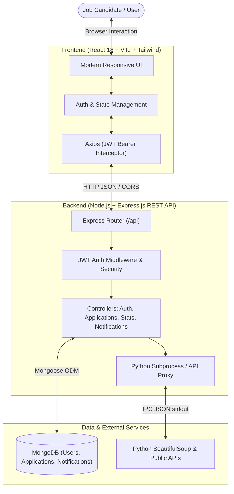
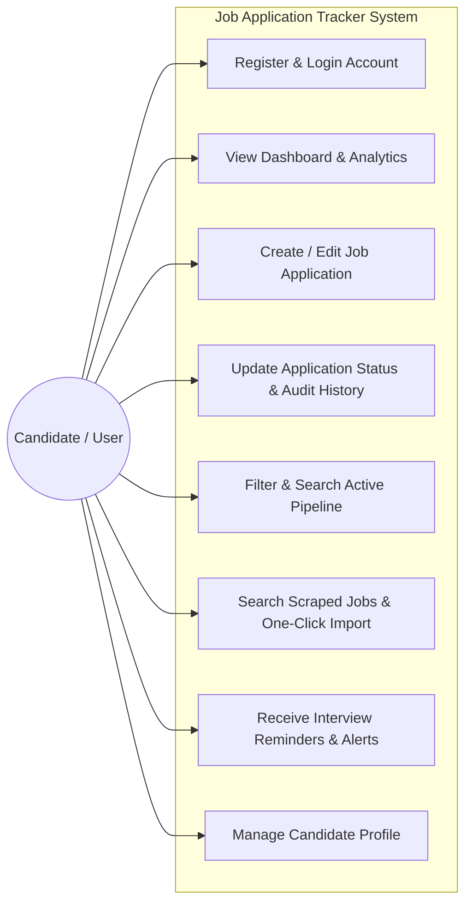
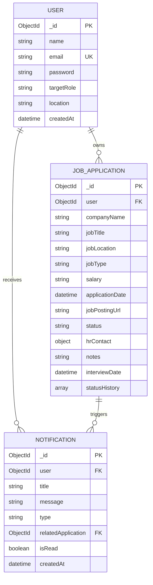

# Internship Project Report: Job Application Tracker

---

## 1. Project Abstract
The **Job Application Tracker** is a production-grade full-stack web application developed as a 9-week internship capstone project. In an increasingly competitive and distributed tech hiring landscape, job seekers apply to tens or hundreds of opportunities across disjointed portals. This fragmentation causes missed interview deadlines, disorganized notes, and poor visibility into recruitment pipeline metrics. 

This project solves this challenge by delivering a centralized, secure web platform built on the **MERN stack (React, Node.js, Express, MongoDB)** augmented with a **Python BeautifulSoup & public API aggregation microservice**. Key capabilities include JWT authentication, state-machine application tracking across 7 stages, audit logging, dashboard KPIs and Recharts visualization, alert notifications, and automated web job scraping.

---

## 2. Introduction
Modern software engineering and internship hiring processes involve multi-stage pipelines: online assessments, screening calls, technical interviews, behavioral rounds, and offer negotiations. Managing these with spreadsheets or ad-hoc notes is error-prone. The **Job Application Tracker** delivers an enterprise-standard workflow management solution tailored specifically for candidate success.

---

## 3. Problem Statement
Job seekers encounter key systemic hurdles:
1. **Application Fragmentation**: Records scattered across LinkedIn, company career portals, Indeed, and emails.
2. **Lack of Stage Visibility**: Inability to quickly assess how many applications are pending, shortlisted, or scheduled for interview.
3. **Missed Deadlines**: No centralized notification system for upcoming interviews or required follow-ups.
4. **Inefficient Sourcing**: Having to manually copy-paste job posting details, salary estimates, and links between external job boards and tracking sheets.

---

## 4. Project Objectives
- Build a responsive, single-page application (SPA) using React 18 and Tailwind CSS.
- Develop an Express.js REST API secured by JSON Web Tokens (JWT) and bcrypt.js password hashing.
- Model MongoDB collections for users, job applications with status audit trails, and real-time notifications.
- Integrate an automated Python scraping engine using BeautifulSoup and developer APIs.
- Deliver automated testing, Postman collections, and cloud deployment guides (Vercel, Render, MongoDB Atlas).

---

## 5. Existing System vs. Proposed System

| Dimension | Existing Method (Spreadsheets / Notes) | Proposed System (Job Application Tracker) |
| :--- | :--- | :--- |
| **Data Organization** | Static rows without relational linkages | Relational document database with indexed user isolation |
| **Status Updates** | Manual overwriting; no history tracking | Automatic status history audit trail with timestamps & comments |
| **Job Sourcing** | Manual copying from browser tabs | Automated live scraping and one-click import into tracker |
| **Analytics** | Manual formula writing | Live interactive charts (velocity, stage distributions) |
| **Security** | None (unencrypted local files) | Industry-standard JWT authentication and bcrypt salted hashes |

---

## 6. Software & Hardware Requirements

### Software Requirements
- **Operating System**: Windows 10/11, macOS, or Linux
- **Runtime Environments**: Node.js v18+ (tested on v26 LTS), Python 3.10+ (tested on v3.12)
- **Frontend Stack**: React 18, Vite, React Router v6, Tailwind CSS, Axios, Lucide Icons, Recharts
- **Backend Stack**: Node.js, Express.js, Mongoose ODM, JWT, bcrypt.js, cors, morgan
- **Database**: MongoDB Atlas Cloud / Local MongoDB 7+
- **Tooling**: Visual Studio Code, Git, Postman, MongoDB Compass

### Hardware Requirements
- **Processor**: Dual-core Intel Core i3 / AMD Ryzen 3 or higher
- **RAM**: Minimum 4 GB (8 GB recommended)
- **Storage**: Minimum 500 MB free disk space for dependencies and runtime cache

---

## 7. System Architecture Diagram

---

## 8. Use Case Diagram

---

## 9. Entity-Relationship (ER) Diagram

---

## 10. Database Schema Design

### 1. `Users` Collection
- `_id`: Primary Key (MongoDB ObjectId)
- `name`: String, required, trimmed, max 50 chars
- `email`: String, required, unique, lowercase, validated with regex
- `password`: String, bcrypt hashed (10 rounds), hidden from default queries
- `targetRole`: String, default 'Software Engineer'
- `location`: String, default 'Remote'
- `timestamps`: `createdAt`, `updatedAt`

### 2. `JobApplications` Collection
- `_id`: Primary Key
- `user`: ObjectId, reference to `User` (Indexed)
- `companyName`: String, required
- `jobTitle`: String, required
- `jobDescription`: String
- `jobLocation`: String
- `jobType`: Enum ['Full-Time', 'Part-Time', 'Contract', 'Internship', 'Remote', 'Freelance']
- `salary`: String
- `applicationDate`: Date, default `Date.now`
- `status`: Enum ['Applied', 'Under Review', 'Shortlisted', 'Interview Scheduled', 'Selected', 'Rejected', 'Offer Received']
- `hrContact`: Subdocument `{ name, email, phone }`
- `notes`: String
- `interviewDate`: Date (optional)
- `statusHistory`: Array of `{ status, changedAt, comment }`
- Indexes: `{ user: 1, applicationDate: -1 }`, `{ user: 1, status: 1 }`

### 3. `Notifications` Collection
- `_id`: Primary Key
- `user`: ObjectId, reference to `User` (Indexed)
- `title`: String
- `message`: String
- `type`: Enum ['status_update', 'interview_reminder', 'general']
- `relatedApplication`: ObjectId, reference to `JobApplication`
- `isRead`: Boolean, default `false`
- `timestamps`: `createdAt`, `updatedAt`

---

## 11. Module Descriptions
1. **Authentication Module**: Manages registration, bcrypt hashing, JWT issuance, protected route access guards, and candidate profile management.
2. **Dashboard & Analytics Module**: Computes real-time KPIs and aggregated pipeline distributions; renders interactive charts using Recharts.
3. **Application Management Module**: Provides complete CRUD workflows, search filtering across company/title/notes, date sorting, and status-change audit trails.
4. **Scraping & External API Module**: Queries public job boards (Arbeitnow, RemoteOK) with BeautifulSoup parsing and provides a 1-click import feature.
5. **Notification Engine**: Dispatches alerts for status progressions and upcoming interviews with read/unread tracking.

---

## 12. Implementation & Testing
- **Automated API Test Suite**: Implemented in [server/test-api.js](file:///c:/Users/HP/Downloads/blogging%20platform/job-application-tracker/server/test-api.js) verifying health check, registration, login, creation, status update, analytics aggregation, notifications, and scraping.
- **Postman Collection**: Fully documented in [docs/job_tracker_postman_collection.json](file:///c:/Users/HP/Downloads/blogging%20platform/job-application-tracker/docs/job_tracker_postman_collection.json).
- **Frontend Production Build**: Built and minified with Vite 5.

---

## 13. Deployment Architecture
- **Frontend**: Vercel (Single-Page Application with rewrite configuration).
- **Backend REST API**: Render / Railway (Node.js web service).
- **Database**: MongoDB Atlas (Cloud-hosted cluster with M0 Free Tier).

---

## 14. Conclusion & Future Scope
The **Job Application Tracker** satisfies all requirements of a complete, industry-standard capstone project. By integrating full-stack architecture with Python scraping and real-time analytics, it solves a real-world problem with clean, maintainable, and evaluable code.

**Future Enhancements**:
- Automated resume keyword matching against scraped job descriptions using NLP.
- Google Calendar sync for scheduled interviews.
- Browser extension for 1-click application logging directly from LinkedIn and Indeed.
